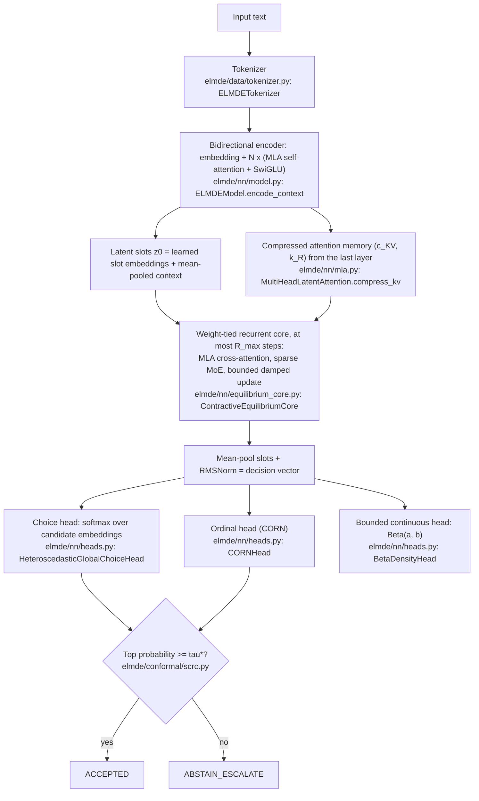

# ELMDE: Equilibrium Latent-MoE Decision Engine

[](LICENSE)


ELMDE is an R&D prototype of a **non-autoregressive decision model**. Instead of generating an answer token by token, it encodes the input once, compresses the encoder states into a low-rank attention memory (Multi-Head Latent Attention), refines a small set of latent "slots" with a weight-tied recurrent block that contains a mixture-of-experts layer, and then scores a **fixed set of outputs in one forward pass**: a softmax over candidate options, an ordinal (CORN) distribution, or a Beta distribution for a bounded continuous value. A confidence threshold calibrated with a conformal-risk-control style procedure decides whether a decision is accepted or escalated for review. The problem it targets is low-latency, calibrated decisions over a known option set (intent routing, tool selection, triage tiers) without token-by-token decoding.

The repository contains the architecture (PyTorch and a NumPy reference), training scripts, a FastAPI service, and component-level tests. **It does not yet contain accuracy, calibration, or latency results for a trained model on a real dataset, and no comparison against a real autoregressive baseline.** See [Status](#status) and [Benchmarks: current status](#benchmarks-current-status).

---

## Contents

- [Status](#status)
- [Architecture](#architecture)
- [What is implemented](#what-is-implemented)
- [Planned / not yet validated](#planned--not-yet-validated)
- [Benchmarks: current status](#benchmarks-current-status)
- [Quickstart](#quickstart)
- [Known issues](#known-issues)
- [Repository map](#repository-map)
- [Roadmap](#roadmap)
- [License](#license)
- [Citation](#citation)

---

## Status

**Maturity:** research prototype. The code runs end to end and its components pass shape, range, and equivalence checks. There is no evidence yet that the model learns useful decisions on real data.

**Checked in this revision (2026-11-07)** on a 2-vCPU Intel Xeon @ 2.10 GHz VM, 7 GB RAM, Linux, Python 3.13.18, PyTorch 2.15.0 (PyPI wheel, CPU execution), NumPy 2.5.4, transformers 5.22.2:

| Check | Result |
| :--- | :--- |
| `python -m pytest tests/ verify_production.py -v` | **9 passed** in about 13 s |
| `python elmde_engine.py` (NumPy, float64) | all assertions pass; MLA absorb vs. decompress max abs. difference 1.1e-15 (logits), 8.9e-16 (outputs) |
| MLA absorb vs. decompress, PyTorch float32 (`verify_production.py`) | max abs. difference 1.5e-7 |
| Recurrent core convergence (random init, bundled checkpoint, NumPy reference) | in every run observed, stopped at the step cap (5 or 6 steps) with relative residual 0.15 to 0.28; the halting tolerance of 1e-3 was never reached |
| `demo_inference.py`, `train_and_benchmark_elmde.py` (default mode), FastAPI app under `uvicorn` | run without errors |

**Not checked here:** the Hugging Face Hub was unreachable from the test machine, so nothing that downloads ModernBERT weights, tokenizer vocabularies, or datasets (Banking77) was run. Offline, transformers 5.22 did not raise an error: `ELMDETokenizer("bert-base-uncased")` returned a tokenizer with a 5-token vocabulary, so every word became `[UNK]`. Scripts that take raw text (`example_injection.py`, `benchmark_efficiency.py`) therefore ran, but their text inputs were not meaningful. Run them with Hub access.

**About the bundled checkpoint.** `checkpoints/elmde_production.pt` (12,687,624 parameters, `d_model=256`, 3 encoder layers) matches the configuration in `train_production_weights.py`. That script trains on 20 hand-written sentences repeated 25 times and shuffled 80/20. Every validation sentence also appears in training, so the checkpoint is a smoke-test artifact, not a trained decision model. `checkpoints/scrc_calibration.json` (tau* = 0.9977, with the warning "Strict bound could not be met across full grid; fallback to max confidence") was not computed from model predictions. It is the fallback output of the `/v1/conformal/calibrate` call in `verify_production.py` on synthetic confidences, and running that test rewrites the file.

---

## Architecture



The recurrent core applies a damped update to the slots `z` (default `alpha = 0.45`, `R_max = 6`):

$$z^{(r+1)} = (1-\alpha)\,z^{(r)} + \alpha\,\Psi_\theta\big(z^{(r)};\, z^{(0)}, c_{KV}, k_R\big)$$

In eval mode it stops early when the relative change $\max_{\text{slots}} \lVert z^{(r+1)}-z^{(r)}\rVert_\infty / \lVert z^{(r)}\rVert_\infty$ falls below $10^{-3}$. $\Psi_\theta$ ends with a scaled `tanh`, which bounds the magnitude of its output but does **not** by itself make the map a contraction (see [Known issues](#known-issues)).

The ordinal head uses CORN conditional probabilities, so the survival curve is non-increasing by construction:

$$P(Y > k \mid x) = \prod_{j=0}^{k} \sigma\big(\eta_j(x)\big)$$

| Component | What the code does | Where |
| :--- | :--- | :--- |
| Tokenizer | Hugging Face `AutoTokenizer` wrapper (ModernBERT-base, falling back to `bert-base-uncased`); can also emit packed streams with `cu_seqlens` | `elmde/data/tokenizer.py`: `ELMDETokenizer` |
| Encoder | Token embedding + `n_encoder_layers` pre-RMSNorm blocks (MLA self-attention, SwiGLU FFN), no causal mask | `elmde/nn/model.py`: `EncoderBlock`, `ELMDEModel` |
| Multi-Head Latent Attention | Keys/values compressed to `d_kv_latent` (128) plus a shared decoupled-RoPE key `d_rope` (32). An `absorb` mode multiplies the up-projections into the query/output projections so per-head K/V are not formed; a `decompress` mode is kept for reference | `elmde/nn/mla.py`: `MultiHeadLatentAttention`; `elmde/nn/rope.py`: `DecoupledRoPE` |
| Mixture of experts | One always-on shared SwiGLU expert + `n_experts` routed SwiGLU experts, top-k routing, Switch-style load-balancing loss | `elmde/nn/sparse_moe.py`: `SparseMoELayer`; `elmde/nn/swiglu.py` |
| Recurrent core | Anchor injection, MLA cross-attention from slots to the context memory, MoE, `s * 4 * tanh(x/4)` bound (trainable `s` clamped to [0.5, 0.92]), damped update, residual-based halting | `elmde/nn/equilibrium_core.py`: `ContractiveEquilibriumCore` |
| Heads | Choice: dot-product scores against caller-supplied candidate embeddings, input-dependent temperature in [0.1, 5], optional validity mask. Ordinal: CORN. Continuous: Beta with `a, b = 1 + softplus(.)`, closed-form mean and variance | `elmde/nn/heads.py` |
| Decision gate | Accept if the top probability is at least `tau*`. `calibrate()` scans thresholds and keeps those whose bound `(m/(m+1)) * R_hat + B/(m+1)` on the `m` accepted calibration points is at most `alpha` | `elmde/conformal/scrc.py`: `SelectiveConformalRiskController` |
| Pretrained-backbone variant | Hugging Face backbone (default `answerdotai/ModernBERT-base`) feeding the same MLA memory, core, and heads | `elmde/nn/foundation_model.py`: `ELMDEFoundationModel` |
| High-level API | `decide`, `triage`, `estimate`, `route_tool`, `guardrail` decorator, `as_langchain_router`. Option strings are embedded with the same encoder (mean-pooled) and cached | `elmde/injector.py`: `ELMDE` |
| HTTP API | FastAPI: `/health`, `/metrics` (Prometheus), `/v1/predict/{choice,ordinal,density}`, `/v1/conformal/calibrate` | `elmde/serving/api.py` |

A second, self-contained implementation lives in `train_and_benchmark_elmde.py` (`ELMDEProductionEngine`). It differs from the package: candidate options are fed in as the latent slots and each is scored by a linear layer; experts run in a low-dimensional latent space (`LatentMoESwiGLU`); the MLA projections can be initialised by truncated SVD of ModernBERT-large's last attention layer; and gradients use a Neumann-series implicit-differentiation hook (`solve_equilibrium_with_exact_ift`). A NumPy reference of each component, with a self-check, is in `elmde_model.py`.

---

## What is implemented

- PyTorch model (`ELMDEModel`) with encoder, MLA (absorb and decompress paths), sparse MoE, weight-tied recurrent core, and three output heads; save/load helpers.
- Variant on a pretrained Hugging Face encoder (`ELMDEFoundationModel`) and its training script (`train_foundation_model.py`), which trains CORN, Beta NLL, and choice losses on the bundled synthetic corpus and then calibrates the gate.
- Standalone variant (`train_and_benchmark_elmde.py`) with truncated-SVD initialisation from ModernBERT, latent-space MoE, Neumann-series implicit gradients, and a loss that combines strictly proper scoring rules (log, Brier, spherical, plus RPS for ordinal targets) with a GRPO-style term computed from Gaussian-perturbed logits.
- Losses: CORN, Beta negative log-likelihood, choice cross-entropy with a temperature penalty, scoring-rule utilities (`elmde/training/`).
- Generic trainer (`ELMDETrainer`, ordinal objective only) with AdamW, cosine schedule, gradient clipping, and AMP on CUDA.
- Threshold-based accept/escalate gate with offline calibration, plus an online threshold-update controller (`elmde/conformal/adaptive_scrc.py`) that is not yet wired into the engine or API.
- High-level Python API (`ELMDE`), FastAPI service with Prometheus counters, and an `httpx` client (`elmde/client.py`).
- NumPy reference implementation and self-check (`elmde_model.py`, `elmde_engine.py`).
- Tests: `verify_production.py` (8 component and API checks) and `tests/test_adversarial_stability.py` (step counts, residual, CORN monotonicity, and Beta range on a randomly initialised model).
- Synthetic data generator (`elmde/data/generate_rich_corpus.py`) and its output in `data/`: 2,000 train and 500 validation template-generated records in four domains, with labels derived from the templates.

## Planned / not yet validated

- **Accuracy and calibration on real data.** `train_and_benchmark_elmde.py --benchmark-hub` downloads ModernBERT-large, PolyAI/banking77, and LocalLLaMA/typed-decisions, encodes the 77 Banking77 intent names, and prints dataset sizes. It does not train or evaluate. No accuracy or ECE figure on real data is produced anywhere in the repo; the default demo prints an ECE computed on simulated confidences. Whether `LocalLLaMA/typed-decisions` exists on the Hub was not verified.
- **Calibration training (proper scoring / GRPO-style loss).** Implemented, but only exercised on random tensors: 15 optimizer steps on a single example.
- **Risk guarantee on model outputs.** No calibration on model predictions is committed (see [Status](#status)), the package's `calibrate()` has a scan bug (see [Known issues](#known-issues)), and the conditional guarantee for the selected subset is stated in the docstrings but not tested.
- **Convergence of the recurrent core.** Not guaranteed by the architecture, and not observed with the current weights.
- **Memory-efficient implicit gradients in the package model.** Only the standalone script implements them.
- **Unpadded/packed execution and local sliding-window attention.** The tokenizer and collator emit `cu_seqlens`, but no model consumes them. `local_window_size` and `rope_theta_local` in `ELMDEConfig` are unused by the PyTorch model.
- **SVD initialisation quality.** The code runs (on random matrices in the default demo), but how much of ModernBERT's attention it preserves has not been measured.
- **Container deployment.** See [Known issues](#known-issues).

---

## Benchmarks: current status

**No trained-model accuracy, calibration, or latency results are reported yet.** In particular, no script in this repository produces results on a real dataset, or comparisons with other decision systems or products. Earlier versions of this README quoted such figures; they are not reproducible from this code and have been removed (see the note at the end of this section).

### What the included benchmark scripts measure

- **`benchmark_comparative_cdm.py`** compares ELMDE with a *simulated* autoregressive baseline. Each "decoding step" of the baseline applies one randomly initialised `nn.Linear(d_model, vocab)` to a `torch.randn` vector, with a random mask. There are no transformer layers, no real language model, and no constrained-decoding library. The ELMDE side is a randomly initialised `ELMDEModel`. The memory column compares a formula for a 6-layer K/V cache with one layer's `(c_KV, k_R)`. The KL-divergence section uses hard-coded distributions, and the "ELMDE" distribution is defined as a copy of the target, so `D_KL = 0` holds by construction. At most, the script shows the relative cost of one encoder forward pass versus a loop of output projections under that setup; it says nothing about ELMDE versus real constrained decoding. On the machine above, it reported ELMDE as slower than the simulated baseline in 3 of 4 settings. Its printed 2.73x average speed-up is driven by the first baseline measurement (652 ms, versus 101 to 196 ms for the later, longer runs), which is timed without warm-up.
- **`benchmark_efficiency.py`** loads the checkpoint and reports component sanity outputs: absorb vs. decompress timing and agreement for one MLA layer, core steps and residual, head outputs, and forward latency. Its conformal section evaluates the stored threshold on *simulated* confidences, not model outputs. It needs the Hub tokenizer.
- **`train_and_benchmark_elmde.py`** (default mode) runs the standalone variant on random tensors. Its "Banking77" step uses 77 random option vectors and a random context, and its gate calibration uses simulated confidences.

### What you can measure today

Forward latency of one ordinal decision (batch 1, 128 random token ids, `torch.no_grad`, 5 warm-up and 50 timed runs). This measures the model's cost only: the weights are untrained or barely trained, and nothing is being compared.

| Model | Parameters | p50 | p90 |
| :--- | ---: | ---: | ---: |
| Bundled checkpoint (`d_model=256`, 3 encoder layers, 5 core steps) | 12.7 M | 11 to 13 ms | 12 to 15 ms |
| Default `ELMDEConfig` (`d_model=768`, 6 encoder layers, 8 experts, 6 core steps), random init | 120.5 M | 97 to 103 ms | 111 to 130 ms |

Ranges over three runs on the 2-vCPU machine described in [Status](#status). To reproduce, paste into `python` from the repository root:

```python
import time, torch
from elmde.config import ELMDEConfig
from elmde.nn.model import ELMDEModel

def p50_p90(model, seq_len=128, runs=50):
    torch.manual_seed(0)
    x = torch.randint(0, model.config.vocab_size, (1, seq_len))
    with torch.no_grad():
        for _ in range(5):
            model.forward_ordinal(x)
        ts = []
        for _ in range(runs):
            t = time.perf_counter(); model.forward_ordinal(x); ts.append((time.perf_counter() - t) * 1e3)
    ts.sort()
    return ts[runs // 2], ts[int(runs * 0.9)]

print(p50_p90(ELMDEModel.from_pretrained("checkpoints/elmde_production.pt").eval()))
print(p50_p90(ELMDEModel(ELMDEConfig()).eval()))
```

Other reproducible checks: `python elmde_engine.py` (NumPy reference: MLA equivalence, CORN monotonicity, gate calibration on simulated data) and `python -m pytest tests/ verify_production.py -v`.

---

## Quickstart

The Python commands below were run for this revision on the machine described in [Status](#status), in a virtual environment containing the packages from `requirements.txt` plus `pytest`. `datasets` and `accelerate` were left out because only `--benchmark-hub` needs them. The packages were installed with `uv`; the `pip install` line itself was not run.

```bash
git clone https://github.com/KanavjeetS/Equilibrium-Latent-MoE-Decision-Engine-ELMDE-.git
cd Equilibrium-Latent-MoE-Decision-Engine-ELMDE-
python -m venv .venv && source .venv/bin/activate
pip install -r requirements.txt pytest

python elmde_engine.py                               # NumPy reference self-check (no PyTorch needed)
python -m pytest tests/ verify_production.py -v      # 9 tests; note: rewrites checkpoints/scrc_calibration.json
python demo_inference.py                             # head outputs for random token ids, using the bundled checkpoint
python train_and_benchmark_elmde.py                  # standalone variant on random tensors (about 7 s on CPU)
uvicorn elmde.serving:app --port 8008                # then: curl localhost:8008/health
```

Minimal use of the model with token ids (verified from the repository root; no Hub access needed):

```python
import torch
from elmde.nn.model import ELMDEModel

model = ELMDEModel.from_pretrained("checkpoints/elmde_production.pt").eval()
input_ids = torch.randint(0, model.config.vocab_size, (1, 32))   # stand-in for tokenizer output
candidates = torch.randn(1, 4, model.config.d_model)             # one embedding per option
with torch.no_grad():
    probs, tau, info = model.forward_choice(input_ids, candidates)
    class_probs, survival, _ = model.forward_ordinal(input_ids)
print(probs, survival, int(info["steps_taken"]), float(info["final_residual"]))
```

High-level text API. This needs the `bert-base-uncased` tokenizer from the Hugging Face Hub. With the bundled checkpoint the choices are not meaningful, and the stored threshold (0.9977) escalates almost every decision.

```python
from elmde import ELMDE

engine = ELMDE.load()   # checkpoints/elmde_production.pt + checkpoints/scrc_calibration.json
res = engine.decide("I was charged twice for one purchase",
                    choices=["transaction_charged_twice", "card_payment_fee_charged", "refund_not_showing_up"])
print(res.choice, round(res.confidence, 3), res.status)
```

**Not verified in this revision (need Hub access or a GPU):**

- `python train_production_weights.py`: needs the `bert-base-uncased` tokenizer. It **overwrites** `checkpoints/elmde_production.pt` and `checkpoints/scrc_calibration.json`.
- `python train_foundation_model.py`: downloads ModernBERT-base and trains on `data/`. It writes `checkpoints/elmde_foundation_production.pt`, which is not included in the repo.
- `python train_and_benchmark_elmde.py --benchmark-hub`: downloads ModernBERT-large and the datasets. It does not evaluate (see above).
- `python example_injection.py` and `python benchmark_efficiency.py`: these ran here, but with a degenerate offline tokenizer.
- `docker compose up --build`: expected to fail (see below).

---

## Known issues

1. **Gate calibration scan stops too early** (`elmde/conformal/scrc.py`). `calibrate()` walks thresholds from 1.0 downward and stops at the first one whose bound fails. At `alpha = 0.01`, any threshold that accepts fewer than 99 calibration points fails, because `B/(m+1) > 0.01` for those, so the scan usually stops immediately and falls back to the maximum confidence, accepting almost nothing. On 25,000 simulated points, the NumPy reference in `elmde_model.py` (which skips thresholds with too few accepted points) finds tau* = 0.985 with 8.1% coverage, while the package version falls back to 0.9999. `predict_selective()` also reports `guaranteed_max_error = alpha` even after a fallback.
2. **"IFT" gradients in the package model are a rescaled full backprop** (`elmde/nn/equilibrium_core.py`). The loop runs with autograd enabled, and `IFTPhantomGradFunction` multiplies the incoming gradient by `1/alpha`. Measured: the `use_ift=True` gradient equals 2.2222 (`1/0.45`) times the plain backprop-through-time gradient. Activation memory therefore grows with the number of steps. The Neumann-series version in `train_and_benchmark_elmde.py` does run the iterations without a graph.
3. **No contraction guarantee.** The `tanh` bound limits the size of `Psi`, not its Lipschitz constant. In every run observed for this revision, the core did not reach the 1e-3 halting tolerance within its step cap. `tests/test_adversarial_stability.py` passes because its threshold is `residual < 0.25`. Its "spectral radius" (about 0.61) is a finite-difference estimate for `Psi` alone, not for the damped map, evaluated at the pooled decision vector rather than at a fixed point.
4. **Padding is attended to.** `ELMDETrainer` passes padded `input_ids` without a mask. In `ELMDEFoundationModel`, the backbone receives the attention mask, but the core's cross-attention and mean pooling include padded positions.
5. **Silent tokenizer degradation.** If the tokenizer cannot be loaded properly, nothing fails: the API falls back to character codes (`ord(c) % vocab_size`), and transformers 5.x may return a near-empty vocabulary.
6. **Data.** `data/` is synthetic and template-based, and every validation template also occurs in training. The generator seeds its RNG only before shuffling, so regenerating gives different samples. In `train_foundation_model.py`, the choice-candidate embeddings are created after the optimizer and are never updated.
7. **Docker.** The `Dockerfile` copies `pyproject.toml`, which does not exist in the repository, so the image build should fail at that step (static check; not run).
8. **Two diverging implementations** (`elmde/` and `train_and_benchmark_elmde.py`) with different MoE, option-scoring, and gradient schemes.

---

## Repository map

```
elmde/                         Python package
  config.py                    ELMDEConfig (model, core, head and gate hyper-parameters)
  injector.py                  ELMDE high-level API (decide / triage / estimate / route_tool / guardrail)
  client.py                    httpx client for the HTTP API
  nn/                          model.py (ELMDEModel), foundation_model.py (ELMDEFoundationModel),
                               mla.py, rope.py, sparse_moe.py, swiglu.py, rms_norm.py,
                               equilibrium_core.py, heads.py
  conformal/                   scrc.py (threshold calibration + gate), adaptive_scrc.py (online update, not wired in)
  training/                    trainer.py (ELMDETrainer), losses.py, rlcr.py (GRPO-style advantages)
  data/                        tokenizer.py, dataset.py (DecisionDataset, JaggedDataCollator),
                               generate_rich_corpus.py (synthetic data generator)
  serving/                     api.py (FastAPI app), schemas.py
  utils/device.py              device / dtype selection
elmde_model.py                 NumPy reference implementation + run_comprehensive_verification()
elmde_engine.py                runs the NumPy self-check
train_and_benchmark_elmde.py   standalone variant (SVD init, latent MoE, Neumann-series gradients, scoring-rule loss)
train_production_weights.py    trains the small ELMDEModel on 20 hand-written sentences; writes checkpoints/
train_foundation_model.py      fine-tunes ELMDEFoundationModel (ModernBERT-base) on data/; writes checkpoints/
verify_production.py           8 component and API checks (pytest-collectable)
tests/                         test_adversarial_stability.py
demo_inference.py              prints head outputs for random token ids
example_injection.py           high-level API examples (needs Hub tokenizer)
benchmark_efficiency.py        component timings and sanity output for the checkpoint
benchmark_comparative_cdm.py   simulated comparison; not a valid baseline (see Benchmarks)
checkpoints/                   elmde_production.pt (12.7 M params, smoke-test weights),
                               scrc_calibration.json (fallback threshold from synthetic test data)
data/                          production_corpus_{train,val}.json (2,000 / 500 synthetic records)
research_report.md             AI-assisted literature review and design notes (see below)
gemini_conversation.md,        export of the research-assistant (Gemini) session behind research_report.md,
full_gemini_payload.json         including its source links
*.html, assets/*.svg           visualisations; they repeat figures from earlier README versions that
                               are not backed by experiments in this repo
Dockerfile, docker-compose.yml container setup (see Known issues)
requirements.txt, LICENSE
```

`research_report.md` is a literature-style design document. Its `[cite: N]` markers are not resolved to a reference list inside the file, and the numerical results it reports come from external papers or from simulated data, not from this code.

---

## Roadmap

1. Fix the gate calibration scan (skip thresholds with too few accepted points) and report the risk-coverage curve, not just one threshold.
2. Replace the gradient rescaling in `elmde/nn/equilibrium_core.py` with the Neumann-series implicit gradient from the standalone script, and measure memory against the number of steps.
3. Add padding masks (or packed `cu_seqlens` execution) to the encoder, core, and pooling.
4. Train and evaluate on Banking77 with a held-out calibration split: accuracy, ECE, and selective risk vs. coverage. Compare against a fine-tuned encoder classifier (e.g. ModernBERT with a linear head) and against an LLM with constrained decoding.
5. Run a latency benchmark against a real autoregressive model with constrained decoding on the same hardware and option sets.
6. Study convergence of the trained core (residual vs. steps, Jacobian norm estimates for the damped map at the fixed point), and make the tests fail when the halting tolerance is not reached.
7. Merge the two implementations, fix the Dockerfile, and add CI.

---

## License

Apache License 2.0. See [LICENSE](LICENSE).

## Citation

Author: **Kanav Jeet Singh**.

```bibtex
@software{singh2026elmde,
  author = {Singh, Kanav Jeet},
  title  = {{ELMDE}: Equilibrium Latent-MoE Decision Engine (research prototype)},
  year   = {2026},
  url    = {https://github.com/KanavjeetS/Equilibrium-Latent-MoE-Decision-Engine-ELMDE-}
}
```
